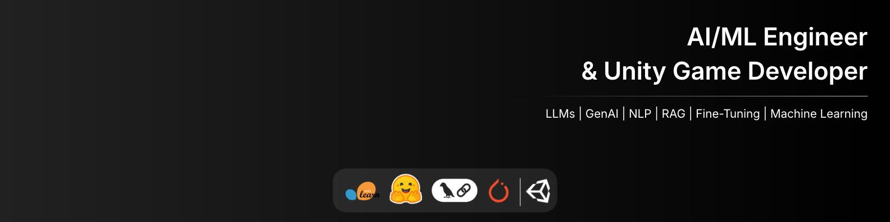
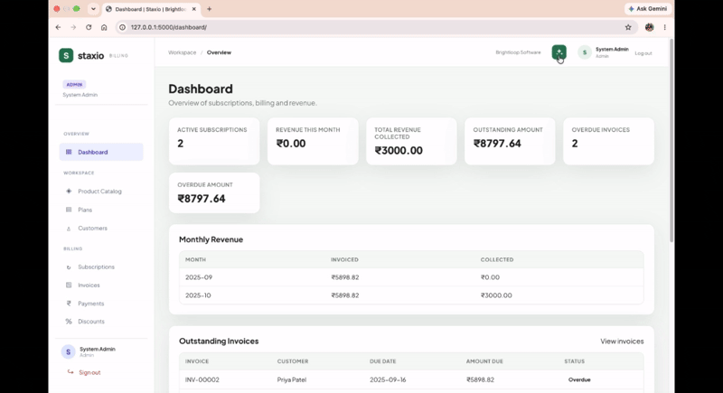

  

 

# Tanmay Khomane

### AI/ML Engineer | Unity Game Developer

  

  

 

---

## About Me

Computer Engineering student at **Pimpri Chinchwad College of Engineering, Pune** | CGPA: **8.64**

- Interested in Machine Learning, Generative AI, NLP and LLMs.
- Building RAG pipelines, fine-tuned models and AI-powered applications.
- Unity Game Developer and Founder of **ArcadeFox Studio**.
- Passionate about practical engineering, problem-solving and continuous learning.
---

## Tech Stack

### AI Engineering & Machine Learning

  
  
  
  
  

`LLMs` · `RAG` · `NLP` · `PEFT / LoRA` · `FAISS` · `Machine Learning`

### Game Development

  
  

`Unity 2D / 3D` · `Gameplay Programming` · `Game Physics` · `Animation` · `Level Design` · `UI Implementation`

### Programming Languages

  
  
  
  

### Tools & Workflow

  
  
  

---

## Recent Project

### Staxio — AI-Powered Subscription Management System

Developed during an 8-hour virtual hackathon, Staxio combines subscription management with an AI assistant for internal business operations.

  

---

## Certifications

- Generative AI Engineering with LLMs Specialization - IBM, Coursera
- Machine Learning Specialization — Stanford University, Coursera
- Game Design and Development using Unity Specialization — Michigan State University, Coursera
- Learn Python Programming Masterclass — Udemy
- Beginning C++ Programming — Udemy

---

## Let's Connect

